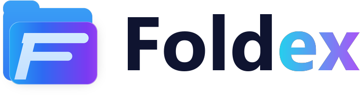
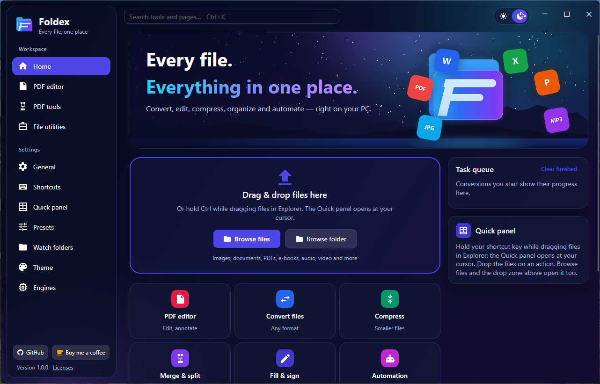
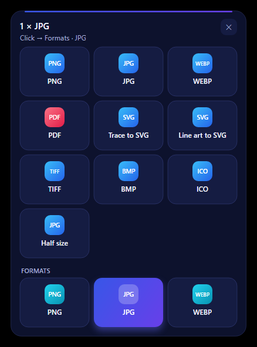
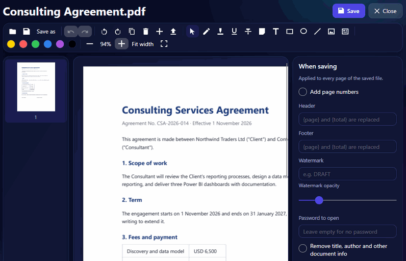
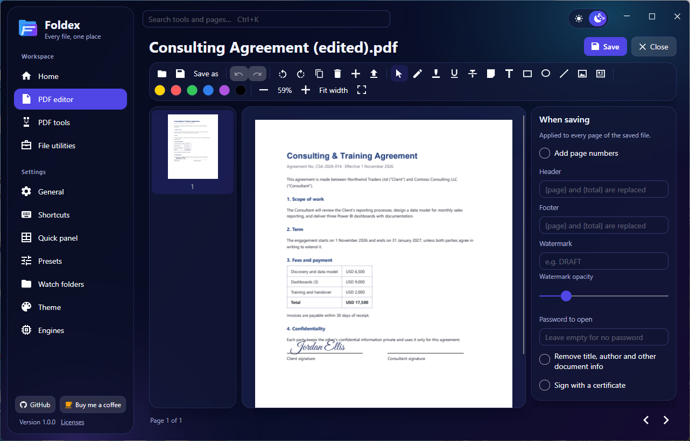
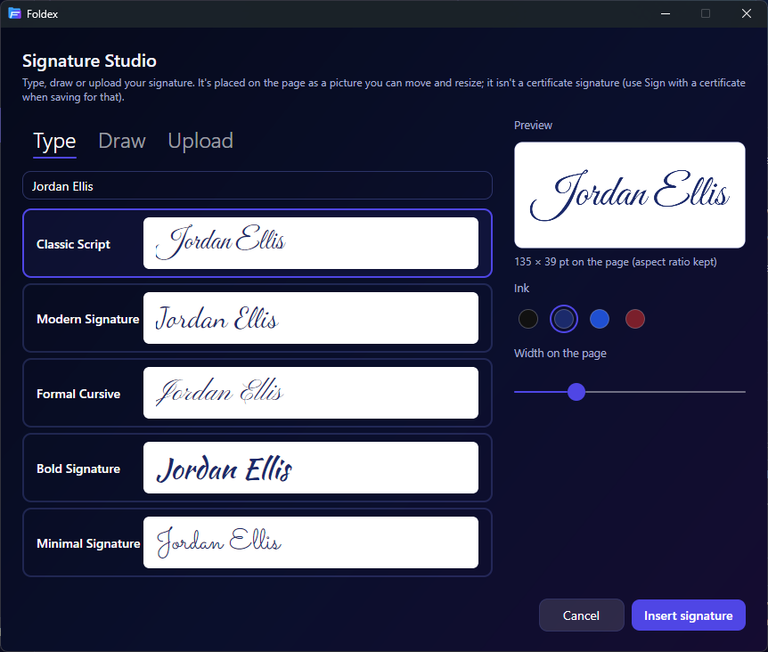
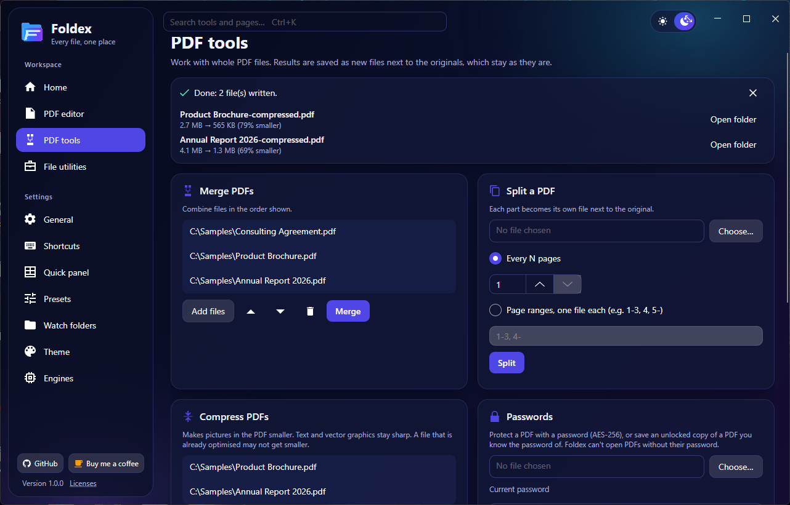
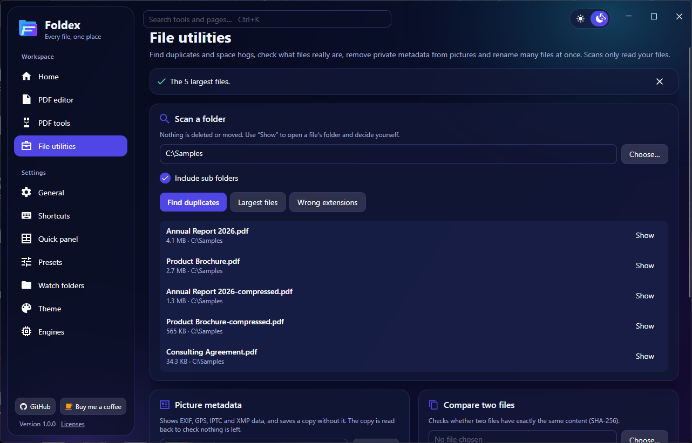
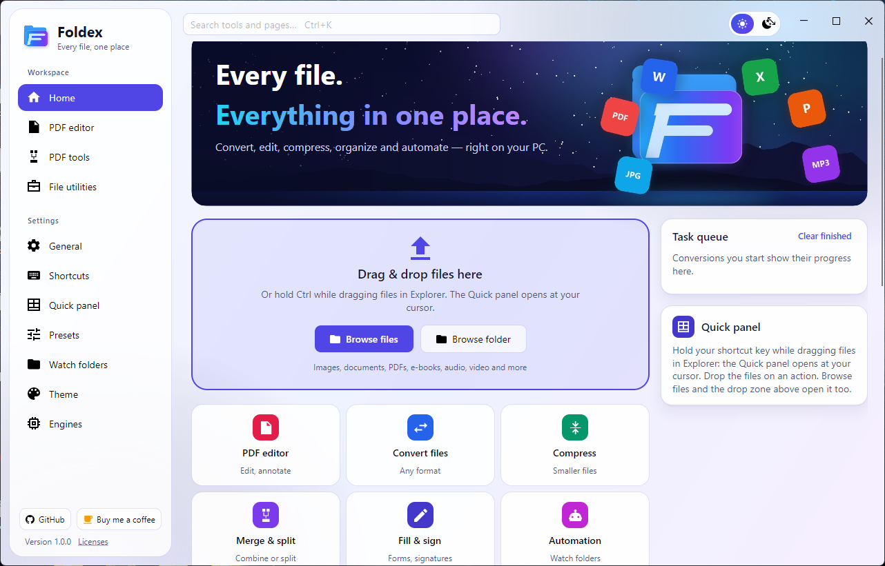

<p align="center">
  <picture>
    <source media="(prefers-color-scheme: dark)" srcset="branding/foldex-logo-dark.png">
    
  </picture>
</p>

<h2 align="center">Convert files. Edit PDFs. One Windows workspace.</h2>

<p align="center">
  A free, open-source Windows app that converts between <b>244 registered formats in 17 categories</b> —
  images, documents, spreadsheets, e-books, audio, video, archives, fonts, CAD, 3D models and more —
  with a PDF editor, Signature Studio, PDF tools and folder utilities built in.
</p>

<p align="center">
  <a href="https://github.com/ShinojJerald/Foldex/releases/latest"></a>
</p>

<p align="center">
  
  
  
  <a href="LICENSE"></a>
</p>

<p align="center">
  <a href="#file-conversion"><b>File conversion</b></a> ·
  <a href="#pdf-editing-and-signatures"><b>PDF editing</b></a> ·
  <a href="#file-and-folder-utilities"><b>File utilities</b></a> ·
  <a href="#download-and-install"><b>Install</b></a> ·
  <a href="#command-line"><b>Command line</b></a> ·
  <a href="#build-from-source"><b>Build</b></a>
</p>

<p align="center">
  
</p>

<table>
  <tr>
    <td width="18%" valign="top">🔁 <b>Convert</b></td>
    <td valign="top">Drop files on the Quick panel, right-click them in File Explorer, set up watch folders or use the <code>foldex</code> command. Conversions run on your PC with built-in engines; a few kinds of conversion need an optional engine you download once.</td>
  </tr>
  <tr>
    <td width="18%" valign="top">📝 <b>Edit PDFs</b></td>
    <td valign="top">Retype a line of existing text, fill standard PDF forms, sign (visually or with a certificate), annotate, rearrange pages, then merge, split, compress, password-protect or OCR.</td>
  </tr>
  <tr>
    <td width="18%" valign="top">🗂️ <b>Tidy folders</b></td>
    <td valign="top">Find duplicate files, the largest files and files with the wrong extension; strip picture metadata; compare two files; rename many files at once.</td>
  </tr>
</table>

## File conversion

Foldex's format registry lists **244 formats across 17 categories**. **169** of them can be written as output; the
other 75 are read as input only (for example camera RAW, Apple Pages / Numbers / Keynote and RAR) and are converted
*to* something else.

A format being in the registry doesn't mean every pair of formats converts. Foldex only offers targets that one of
its engines can actually produce for the file you picked; `foldex formats <format>` shows them for any format.

<table>
  <tr>
    <td width="34%" valign="top"></td>
    <td valign="top">
      <b>How you convert</b><br><br>
      <b>Quick panel</b> — hold <kbd>Ctrl</kbd> while dragging files in File Explorer. The panel opens at your cursor with
      the targets for those files; drop them on one. The shortcut can be changed in Settings → Shortcuts.<br><br>
      <b>File Explorer</b> — right-click files and choose <i>Convert with Foldex</i> (on Windows 11 it's under
      <i>Show more options</i>, and in <i>Send to</i>).<br><br>
      <b>Home</b> — drop files on the drop zone or use <i>Browse files</i> / <i>Browse folder</i>; progress shows in the
      task queue.<br><br>
      <b>Watch folders</b> — files that land in a folder are converted automatically with a preset.<br><br>
      <b>Command line</b> — <code>foldex convert photo.heic --to jpg</code> (see <a href="#command-line">Command line</a>).<br><br>
      Converted files are saved as new files, next to the originals unless you choose another folder.
    </td>
  </tr>
</table>

### Formats by category

| Category | Formats | Examples |
|---|---:|---|
| Images | 36 | PNG, JPG, WEBP, HEIC, AVIF, JPEG XL, TIFF, GIF, ICO, PSD, ICNS; camera RAW, DICOM, OpenEXR (read only) |
| Vector graphics | 12 | SVG, SVGZ, EPS, PS, EMF, WMF, ODG; AI, CDR, VSD (read only) |
| PDF | 1 | PDF |
| Documents | 23 | DOCX, DOC, ODT, RTF, EML; Pages, WPS, WordPerfect, Outlook MSG (read only) |
| Hangul (HWP) | 2 | HWP, HWPX |
| Spreadsheets | 13 | XLSX, XLS, ODS, CSV, TSV; Numbers (read only) |
| Presentations | 11 | PPTX, PPT, ODP, PPSX; Keynote (read only) |
| Text and markup | 14 | TXT, Markdown, HTML, LaTeX, reStructuredText, AsciiDoc, Jupyter, Typst |
| Data | 6 | JSON, JSON Lines, YAML, TOML, XML, vCard |
| E-books and comics | 24 | EPUB, KEPUB, MOBI, AZW3, FB2, CBZ; CBR, CHM (read only) |
| Video | 22 | MP4, MOV, MKV, WEBM, AVI, WMV, MPEG, TS |
| Audio | 30 | MP3, M4A, AAC, WAV, FLAC, OGG, OPUS, WMA, AIFF |
| Archives | 28 | ZIP, 7Z, TAR, TAR.GZ; RAR, ISO, CAB, DMG (read only) |
| CAD | 2 | DWG, DXF |
| Fonts | 5 | TTF, OTF, WOFF, WOFF2, EOT |
| Subtitles | 9 | SRT, ASS, WebVTT, SAMI, LRC, TTML |
| 3D models | 6 | GLB, glTF, STL, OBJ, 3MF, PLY |

The full list, with every extension, is in [`FormatRegistry.cs`](src/Filee.Core/Formats/FormatRegistry.cs); which
engine handles what is in [docs/ENGINES.md](docs/ENGINES.md).

### Engines: what works straight away and what needs a download

Most conversions use engines that are built in or installed with Foldex (ImageMagick, PDFsharp, PDFium, 7-Zip, rhwp and
Foldex's own document, e-book, data, subtitle, font, CAD and 3D converters). Some need an **optional engine**:

| Optional engine | Download (approx.) | Needed for |
|---|---|---|
| **FFmpeg** | 100 MB | All audio and video conversions, video ↔ animated GIF, and writing HEIC images |
| **LibreOffice** (with Java and H2Orestart) | 420 MB | Older and less common office formats: DOC, XLS, PPT, RTF and OpenDocument to PDF and to each other, and the read-only office formats (Pages, WordPerfect, …) |
| **Pandoc** | 42 MB | Markup formats such as LaTeX, reStructuredText, Org and AsciiDoc ↔ DOCX/ODT/HTML/Markdown, and Markdown → PPTX |
| **Ghostscript** | 20 MB | EPS / PS → PDF, PDF → EPS / PS, PostScript-based AI files |
| **Calibre** | 225 MB | Rare e-book formats (LIT, LRF, CHM, PDB, …) and EPUB → MOBI / AZW3 |

On first start Foldex asks which of these to download, and you can install or remove them at any time in
**Settings → Engines**. A conversion that needs a missing engine is marked *Needs FFmpeg* (or the engine it needs)
instead of being attempted. Downloads come from pinned addresses and are checked against a SHA-256 hash before they're
unpacked into `%LOCALAPPDATA%\Foldex\engines`. Microsoft Office isn't needed or used: DOCX, XLSX and PPTX → PDF work
with the built-in engines.

### Example conversions

| From → to | Engine |
|---|---|
| HEIC → JPG, PNG → WEBP, PSD → PNG | Built in |
| DOCX → PDF, XLSX → PDF, Markdown → DOCX | Built in (no Office needed) |
| EPUB → PDF, DWG → PDF, STL → OBJ, TTF → WOFF2 | Built in |
| ZIP / 7Z / RAR → folder, files → ZIP | Built in (7-Zip is installed with Foldex) |
| MP4 → MP3, MOV → MP4, MKV → WEBM | FFmpeg |
| DOC → DOCX, PPT → PDF | LibreOffice |
| LaTeX → DOCX | Pandoc |
| EPS → PDF | Ghostscript |
| LIT → EPUB | Calibre |

## PDF editing and signatures

<p align="center">
  
</p>

- **Edit existing text, line by line** — click a line with the ✎ tool and retype it. The old text is removed from the
  page and the new text is written at the same position, size and colour, in the closest installed font. Foldex reads
  the saved file back to check the change; if a page can't be changed safely, nothing is saved and you're told why.
- **Fill forms** — standard PDF forms (AcroForm): text fields, check boxes, lists and radio buttons, saved into the
  PDF's own form.
- **Signature Studio** — type your name in one of five signature styles, draw it with a mouse, pen or finger, or upload
  a picture of your signature (the white background can be removed). Place it on the page, then move or resize it.
- **Sign with a certificate** — when saving, choose a `.pfx` / `.p12` certificate to add a digital signature (PKCS#7,
  SHA-256) over the whole file.
- **Annotate** — highlight, underline and strike-out that follow the words, sticky notes, text boxes, rectangles,
  ellipses, lines and pictures.
- **Pages** — reorder by dragging thumbnails, rotate, duplicate, delete, insert pages from another PDF and export
  selected pages, with undo and redo.
- **When saving** — page numbers, header and footer, watermark, a password (AES-256) and removing document information.
  The original file is only changed if you save over it, and closing with unsaved changes asks *Save*, *Don't save* or
  *Cancel*.

> [!IMPORTANT]
> **Visual signature vs. certificate signature.** A typed, drawn or uploaded signature is a *picture* of a signature,
> like signing a printout — it proves nothing about who signed or whether the file changed. *Sign with a certificate*
> adds a cryptographic digital signature: PDF viewers can check who signed and whether the document was changed
> afterwards. The certificate signature is invisible on the page, can't be combined with a password, and has no trusted
> timestamp.

<p align="center">
  
</p>

<table>
  <tr>
    <td width="50%" valign="top"><br>
      <b>Signature Studio</b> — five typed styles (bundled fonts), a drawing pad, or an uploaded picture; four ink colours
      and a live preview.</td>
    <td width="50%" valign="top"><br>
      <b>PDF tools</b> — results are saved as new files next to the originals.</td>
  </tr>
</table>

### PDF tools

Merge PDFs in a chosen order · split by page ranges or every N pages · compress, with the size before and after ·
protect with a password (AES-256) or save an unlocked copy of a PDF whose password you know · extract text · **OCR**
scanned PDFs into searchable PDFs using the text recognition built into Windows (it reads the languages Windows has OCR
support installed for).

### What the PDF editor doesn't do

- Text editing works **one line at a time and doesn't reflow paragraphs**: a longer line runs further to the right.
- **Scanned pages have no text to edit** — run OCR first, or add a text box.
- Text on pages stored rotated inside the PDF, and text drawn in unusual ways, can't be changed (Foldex says so).
- **Standard PDF forms (AcroForm) only — XFA forms aren't supported.**
- A shape drawn over text doesn't remove the text underneath, so it isn't redaction. Pictures inside the page can't be
  edited. One PDF is open at a time, and printing is done from your PDF viewer.

Full details: [docs/PDF_FEATURES.md](docs/PDF_FEATURES.md).

## File and folder utilities

<p align="center">
  
</p>

- **Find duplicates** — files with exactly the same content in a folder (and its sub folders), compared by SHA-256.
- **Largest files** — the biggest files in a folder, to see what's using the space.
- **Wrong extensions** — files whose content doesn't match their extension (for example a PNG named `.jpg`).
- **Picture metadata** — view a picture's EXIF, GPS, IPTC and XMP data and save a copy without it; the copy is read back
  to check nothing is left.
- **Compare two files** — whether they have exactly the same content (SHA-256).
- **Batch rename** — rename many files with a pattern (`{name}`, `{n}`, `{date}`, `{ext}`), find and replace and a
  starting number, with a live preview. Existing files are never overwritten.

The scans only read your files: nothing is deleted or moved. *Show* opens a file's folder so you can decide yourself.

### Everyday comfort

Search every tool and page with <kbd>Ctrl</kbd>+<kbd>K</kbd> · light and dark themes · English, 한국어, Polski and
简体中文 · presets for repeated conversions · runs in the notification area and can start when you sign in (Settings → General).

<p align="center">
  
</p>

## Download and install

**[Download the latest release →](https://github.com/ShinojJerald/Foldex/releases/latest)**

| File | What it is |
|---|---|
| `Foldex-1.0.0-win-Setup.exe` | Installer (Windows 10 version 1809 or later, or Windows 11, 64-bit) |
| `Foldex-1.0.0-win-Portable.zip` | Portable version: unzip it anywhere and run `Foldex.exe` |
| `Foldex-1.0.0-SHA256SUMS.txt` | SHA-256 checksums of the two files above |

1. Download the installer (or the portable ZIP) from the [Releases page](https://github.com/ShinojJerald/Foldex/releases/latest).
2. **Check the file before running it.** In PowerShell, in your Downloads folder:

   ```powershell
   Get-FileHash .\Foldex-1.0.0-win-Setup.exe -Algorithm SHA256
   ```

   The hash must match the line for that file in `Foldex-1.0.0-SHA256SUMS.txt` on the release page.
3. Run the installer and start **Foldex** from the Start menu. On first start it asks which optional engines to
   download (you can skip this and add them later in Settings → Engines).

> [!WARNING]
> **The installer isn't code-signed yet**, so Windows SmartScreen may show *"Windows protected your PC"*. Only continue
> (*More info → Run anyway*) if you downloaded the file from this repository's
> [Releases page](https://github.com/ShinojJerald/Foldex/releases) **and** its SHA-256 hash matches the published
> checksum. If either doesn't check out, delete the file.

- Settings are stored in `%APPDATA%\Foldex` and downloaded engines in `%LOCALAPPDATA%\Foldex\engines`.
- Uninstall from **Settings → Apps → Foldex**. Your settings stay unless you delete `%APPDATA%\Foldex`.
- Foldex doesn't check for updates by itself yet. To hear about new versions, use GitHub's
  *Watch → Custom → Releases* on this repository.

## Command line

Tick *Add the "foldex" command to PATH* in the installer, then open a new terminal:

```powershell
foldex convert photo.heic --to jpg
foldex convert *.png --to webp --quality 80 -o converted
foldex convert D:\Scans --recursive --preset to-pdf
foldex watch D:\Inbox --to pdf --move-originals
foldex formats            # every format
foldex formats heic       # what HEIC converts to
foldex presets
foldex help convert
```

The command uses the same engines and presets as the app. Exit codes: 0 all converted, 1 some failed, 2 wrong
arguments or a missing input, 3 nothing to convert.

## Keyboard shortcuts

| Shortcut | Action |
|---|---|
| <kbd>Ctrl</kbd>+<kbd>K</kbd> | Search tools and pages |
| Hold <kbd>Ctrl</kbd> while dragging files in File Explorer | Open the Quick panel at the cursor |
| <kbd>Ctrl</kbd>+<kbd>O</kbd> / <kbd>Ctrl</kbd>+<kbd>S</kbd> / <kbd>Ctrl</kbd>+<kbd>Shift</kbd>+<kbd>S</kbd> | Open / Save / Save as (PDF editor) |
| <kbd>Ctrl</kbd>+<kbd>W</kbd> | Close the PDF |
| <kbd>Ctrl</kbd>+<kbd>Z</kbd> / <kbd>Ctrl</kbd>+<kbd>Y</kbd> | Undo / Redo |
| <kbd>Ctrl</kbd>+<kbd>R</kbd> / <kbd>Ctrl</kbd>+<kbd>Shift</kbd>+<kbd>R</kbd> | Rotate pages right / left |
| <kbd>Ctrl</kbd>+<kbd>D</kbd>, <kbd>Delete</kbd> | Duplicate / delete selected pages (or the selected mark) |
| <kbd>Ctrl</kbd>+<kbd>+</kbd> / <kbd>Ctrl</kbd>+<kbd>-</kbd> / <kbd>Ctrl</kbd>+<kbd>0</kbd> | Zoom in / out / fit page |
| Arrow keys (<kbd>Shift</kbd> for bigger steps) | Nudge the selected mark or signature |

## Privacy and network use

- Conversion, PDF editing, OCR and the file utilities run on your PC. Foldex has no account, no telemetry and no
  online conversion service; OCR uses the text recognition engine built into Windows.
- Foldex connects to the internet only when you ask it to: to download an optional engine (from pinned addresses,
  checked against a SHA-256 hash), or when you choose *Check for updates* in About, which asks GitHub for the latest
  release. Links in the app open in your browser.
- Optional engines such as FFmpeg and LibreOffice run locally as separate programs inside Foldex's own folder.
- Saved signatures stay on your PC in `%APPDATA%\Foldex\signatures`.

## Known limitations

Some conversions need an optional engine download; text editing is line by line without paragraph reflow; scanned
pages need OCR first; XFA forms aren't supported; one PDF is open at a time; the installer isn't code-signed yet; and
Foldex runs on Windows only for now. The full list: [docs/KNOWN_LIMITATIONS.md](docs/KNOWN_LIMITATIONS.md).

## Build from source

You need Windows 10/11 x64 and the [.NET 10 SDK](https://dotnet.microsoft.com/download).

```powershell
git clone https://github.com/ShinojJerald/Foldex.git
cd Foldex
dotnet build Filee.slnx -c Release

# Run without touching an installed Foldex's settings
$env:FILEE_DATA_DIR = "$env:TEMP\foldex-dev"; dotnet run --project src/Filee.App -c Release

# Tests
dotnet test tests/Filee.Engines.Tests -c Release
dotnet test tests/Filee.App.Tests -c Release

# Installer and portable ZIP → Releases\
.\build\build-installer.ps1 -Portable
```

Running from source uses the repository's `engines\` folder, filled by `build\fetch-engines.ps1`. Project names still
start with *Filee* (the codebase Foldex grew from); the app, executable and installer are Foldex.
More: [docs/BUILD_AND_INSTALL.md](docs/BUILD_AND_INSTALL.md) · [docs/ARCHITECTURE.md](docs/ARCHITECTURE.md) ·
[docs/ENGINES.md](docs/ENGINES.md) · [docs/PDF_FEATURES.md](docs/PDF_FEATURES.md) ·
[docs/ADDING-A-CONVERTER.md](docs/ADDING-A-CONVERTER.md).

Foldex has about 1,580 automated tests, including tests that drive the app with simulated mouse and keyboard input and
render saved PDFs to check them; see [docs/TEST_RESULTS.md](docs/TEST_RESULTS.md).

## Contributing

Bug reports, ideas and format requests are welcome in [Issues](https://github.com/ShinojJerald/Foldex/issues). Please
don't attach private documents; a small sample file that shows the problem helps most.

## Support

If Foldex saves you time, you can [buy me a coffee](https://buymeacoffee.com/tunekadal) or follow my work on
[GitHub](https://github.com/ShinojJerald).

## License and credits

Foldex is released under the [MIT License](LICENSE).

- Built on [Filee](https://github.com/KnifeLemon/Filee) by Myeonggu Kim (KnifeLemon) and contributors, MIT License.
  Foldex keeps Filee's converter and adds the PDF workspace, Signature Studio, the file utilities and a new interface.
- Signature fonts (Great Vibes, Dancing Script, Pinyon Script, Kaushan Script, Sacramento) are under the SIL Open Font
  License 1.1; their licence texts are in
  [src/Filee.App/Assets/Fonts/Signatures](src/Filee.App/Assets/Fonts/Signatures) and are installed with the app.
- Other libraries and engines: [THIRD-PARTY-NOTICES.md](THIRD-PARTY-NOTICES.md).
